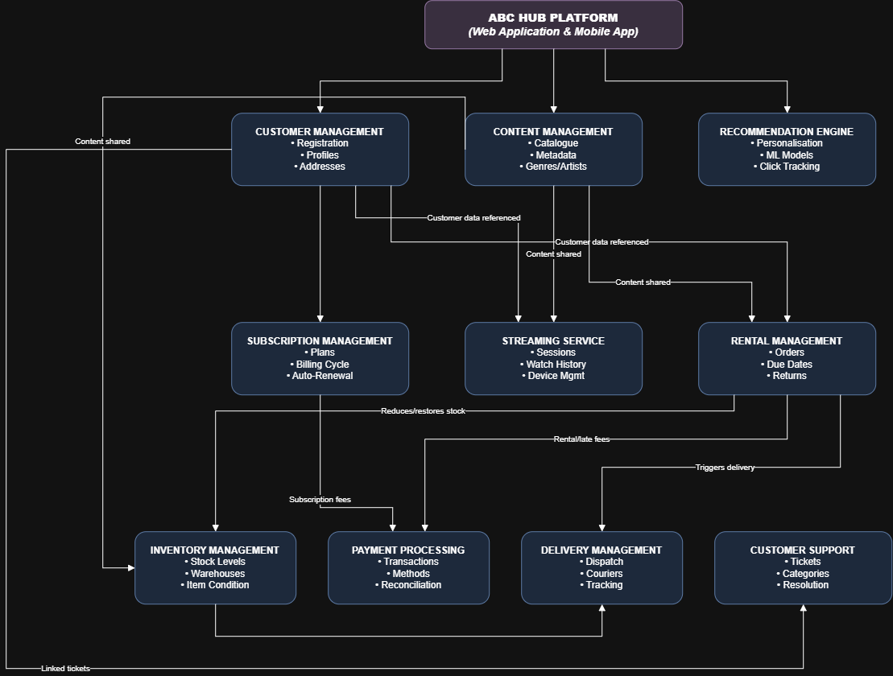
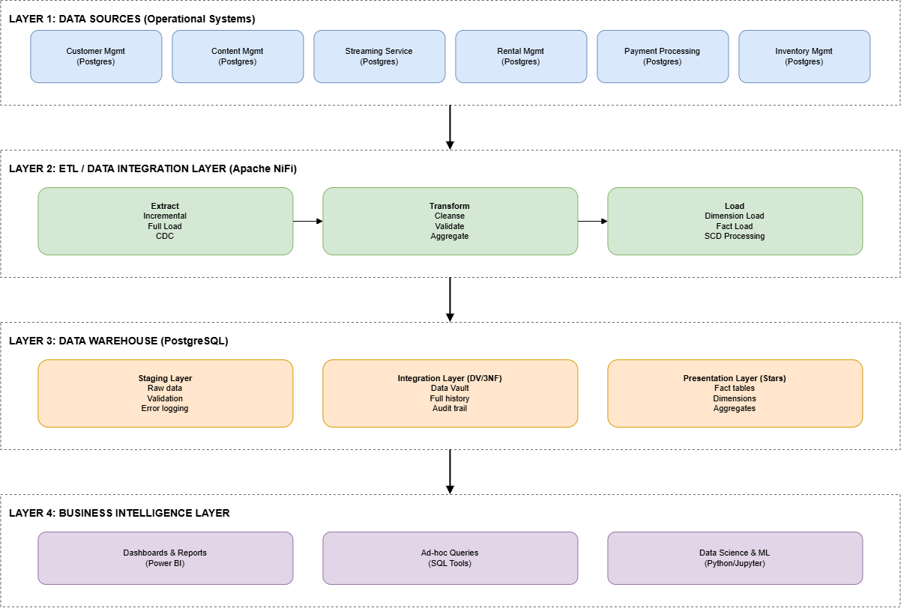
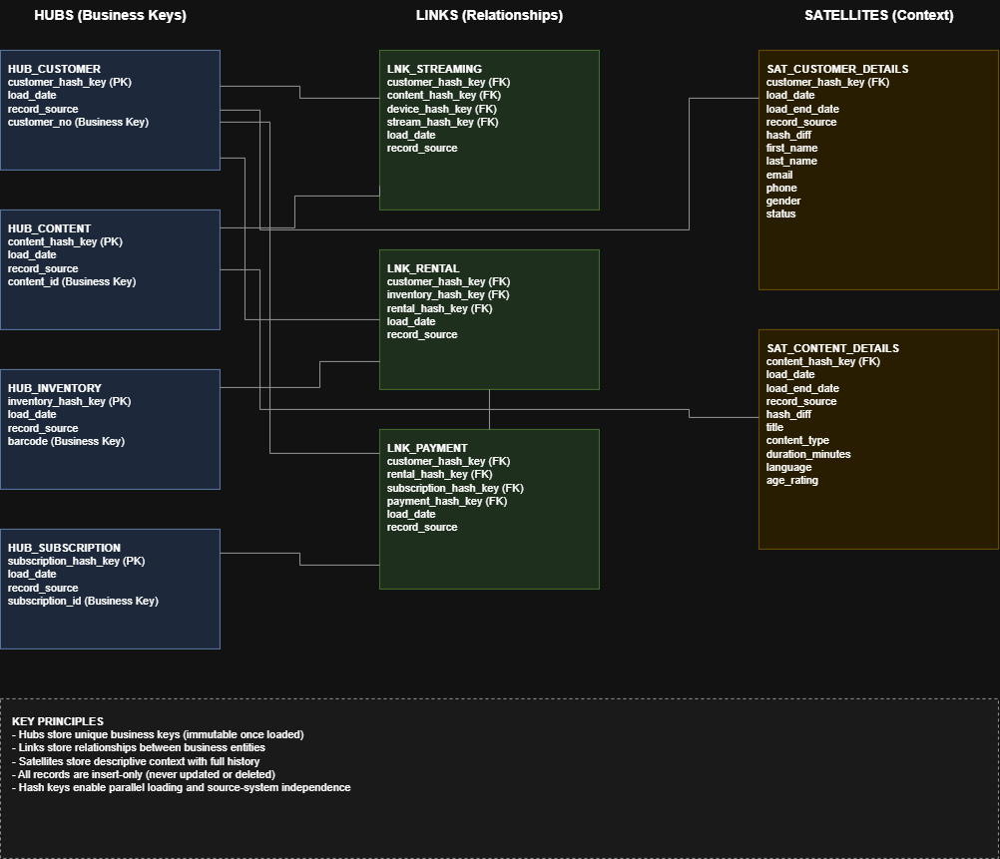
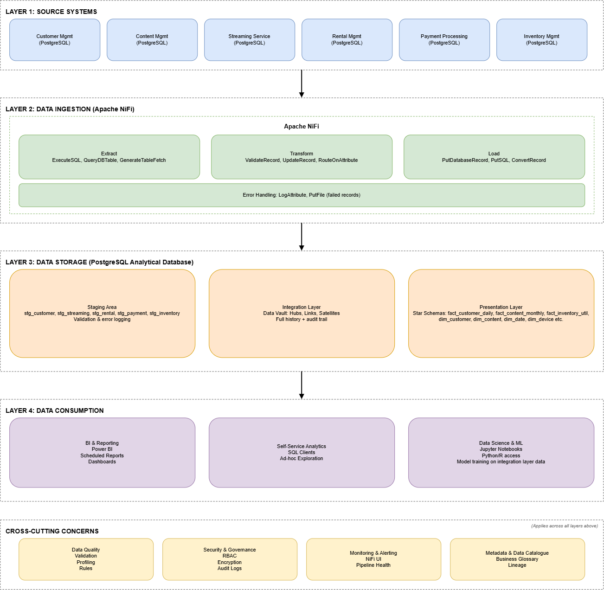
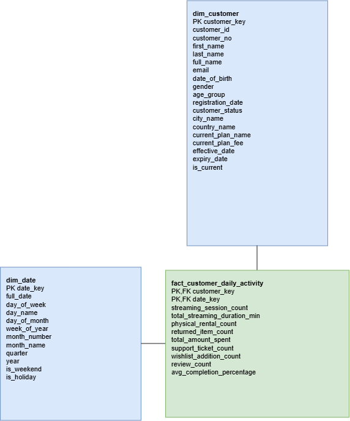
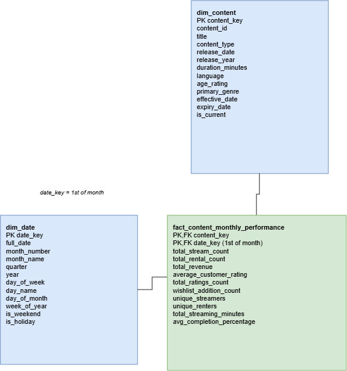
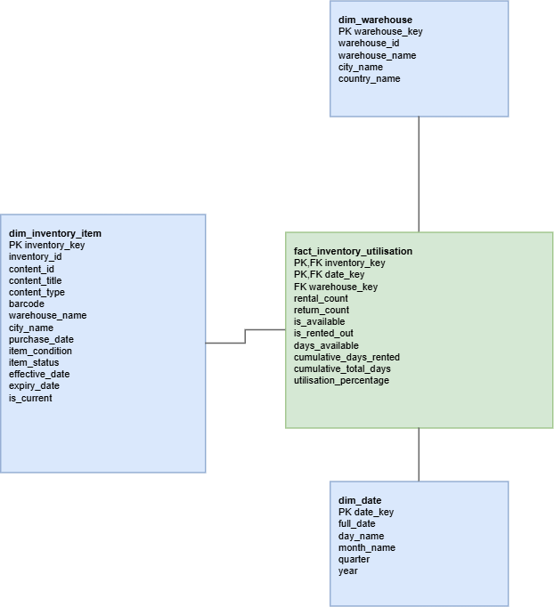

# Mini Project 01: Designing a Modern Data Platform for ABC Hub

## Question 1: Operational Systems Analysis (10 Marks)

### 1.1 Major Operational Systems

Based on the business scenario, the following operational systems generate data within ABC Hub:

| # | Operational System | Purpose | Key Data Generated |
|---|---|---|---|
| 1 | **Customer Management** | Manages customer registration, profiles, and account status | Customer records, addresses, preferences |
| 2 | **Content Management** | Manages digital and physical content catalogue | Content metadata, genres, artists, ratings |
| 3 | **Subscription Management** | Handles streaming plan subscriptions | Subscription records, plan changes, renewals |
| 4 | **Streaming Service** | Delivers digital content to customers | Streaming sessions, watch history, device usage |
| 5 | **Rental Management** | Manages physical item rentals | Rental orders, due dates, returns, late fees |
| 6 | **Inventory Management** | Tracks physical items across warehouses | Stock levels, item conditions, warehouse locations |
| 7 | **Payment Processing** | Processes all financial transactions | Payment records, methods, transaction status |
| 8 | **Delivery Management** | Coordinates physical item dispatch and returns | Delivery tracking, courier assignments, dates |
| 9 | **Customer Support** | Handles customer queries and issues | Support tickets, categories, resolution times |
| 10 | **Recommendation Engine** | Generates personalised content suggestions | Recommendations, algorithm versions, click-through |

### 1.2 High-Level System Interaction Diagram



### System Interactions:
- **Customer Management → All Systems**: Customer data is referenced by every other system
- **Content Management → Streaming, Rental, Inventory**: Content is shared across digital and physical channels
- **Subscription Management → Payment Processing**: Subscription fees trigger recurring payments
- **Rental Management → Inventory Management**: Rentals reduce available stock; returns restore it
- **Rental Management → Delivery Management**: Each rental triggers a delivery workflow
- **Rental Management → Payment Processing**: Rental fees and late fees generate payment records
- **Customer Management → Customer Support**: Support tickets are linked to customer records

---

## Question 2: Reporting Solution Recommendation (10 Marks)

### 2.1 Analysis of Reporting Challenges

| Challenge | Root Cause |
|-----------|-----------|
| Reports take a long time to prepare | Queries run against operational databases not optimised for analytics |
| Different departments report different figures | No single source of truth; each system has its own data definitions |
| Historical trends difficult to analyse | Operational systems designed for current state, not historical tracking |
| Cannot analyse cross-channel behaviour | Data siloed in separate operational systems |
| Business users depend on IT for reports | No self-service BI layer; complex joins required |

### 2.2 Recommended Solution: Enterprise Data Warehouse with BI Layer

The recommended solution is to implement a **Modern Data Warehouse** with a **Business Intelligence (BI) Layer** that separates analytical workloads from operational systems.

**Key Components:**
1. **Data Warehouse**: Centralized repository storing integrated, historical, subject-oriented data
2. **ETL Pipeline**: Automated extraction, transformation, and loading from source systems
3. **BI/Reporting Layer**: Self-service tools for business users (e.g., Power BI, Tableau)
4. **Data Governance**: Standardised definitions, data quality rules, and access controls

### 2.3 High-Level Architecture Diagram



### 2.4 How This Solves Each Challenge:

| Challenge | Solution |
|-----------|----------|
| Slow report preparation | Pre-aggregated fact tables optimised for analytical queries |
| Inconsistent figures | Single source of truth with standardised business rules |
| Difficult historical analysis | Data Vault preserves complete history with timestamps |
| Cross-channel analysis impossible | Integrated star schemas combine streaming and rental data |
| IT dependency for reports | Self-service BI tools with intuitive dimensional models |

---

## Question 3: Analytical Requirements Gathering (15 Marks)

### 3.1 Stakeholder Questions

#### Customer Activity
1. Do you need daily, weekly, monthly, or yearly analysis of customer activity?
2. Should customer activity be analysed by geography (country, city)?
3. Should we differentiate between streaming activity and physical rental activity?
4. Do you want to track active vs. inactive vs. churned customers separately?
5. What KPIs define "activity" (session count, duration, rentals, revenue, support interactions)?
6. Should new customer acquisition be tracked as part of activity?
7. Do you need cohort analysis (group customers by registration date)?

#### Streaming Performance
8. What granularity of time is needed (hourly, daily, monthly)?
9. Should streaming be analysed by device type, content type, or subscription plan?
10. What defines a "successful" stream (completion percentage threshold)?
11. Do you need peak usage analysis (time-of-day patterns)?
12. Should buffering or quality issues be tracked as performance metrics?

#### Physical Rental Trends
13. Should rental trends be analysed by content type (movies, books, games)?
14. Do you need to track late returns and associated fees?
15. Should rental analysis include delivery performance (dispatch-to-delivery times)?
16. Is geographic analysis needed (which cities/countries rent most)?

#### Revenue
17. Should revenue be broken down by source (subscriptions vs. rentals vs. late fees)?
18. What currency handling is needed for international expansion?
19. Do you need revenue forecasting or just historical analysis?
20. Should failed/refunded payments be tracked separately?

#### Content Popularity
21. How should popularity be measured (views, ratings, rentals, wishlists)?
22. Should content popularity account for content age (new vs. catalogue)?
23. Do you need trending analysis (popularity velocity over time)?
24. Should recommendations effectiveness (click-through rate) be measured?

#### Inventory Utilisation
25. What threshold defines an underutilised item?
26. Should utilisation be measured per warehouse or overall?
27. Do you need to track item condition degradation over time?
28. Should the analysis support procurement recommendations?

#### Data Science Requirements
29. How far back does historical data need to go for ML model training?
30. Do you need real-time or near-real-time data for recommendation models?
31. What data formats and access patterns does the data science team prefer?
32. Should the analytical platform support A/B testing of recommendation algorithms?

#### Cross-Cutting Requirements
33. What are the security and access control requirements by role?
34. What data retention policies exist (regulatory or internal)?
35. What is the expected data growth rate over the next 5 years?
36. What is the acceptable query response time for dashboards?
37. How often should the analytical data be refreshed (hourly, daily, weekly)?

#### Business Objectives
*(Added — the brief explicitly lists "business objectives" as a topic area
these questions must clarify; the original 37 questions probed KPIs,
dimensions and technical properties per analytical area, but never asked
what business outcome the platform itself is meant to enable.)*

38. Beyond faster reporting, what specific business decision or outcome should this platform make possible in the next 12 months (e.g. reducing churn, optimising inventory spend, informing the international expansion roadmap)?
39. Which of the four stated challenges (slow reports, inconsistent departmental figures, difficult historical trend analysis, inability to analyse streaming and rental behaviour together) is the highest priority to solve first?
40. Is this platform intended primarily to support internal decision-making, or will it also inform customer-facing features (e.g. recommendations, personalised offers)?
41. Does success mean replacing manual reporting entirely, or is a hybrid (self-service dashboards + occasional ad hoc analyst requests) acceptable?

#### Data Quality Expectations
*(Added — the brief explicitly lists "data quality expectations" as a topic
area these questions must clarify; this was previously addressed only as an
implementation concern in Q6/Q8, not raised as a stakeholder question here.)*

42. What level of data accuracy is acceptable for financial reporting (e.g. revenue figures) versus behavioural/engagement metrics — should the same tolerance apply to both?
43. When a record fails validation (e.g. a rental with a missing return date, a payment with a negative amount), should it be excluded from reports silently, flagged for manual review, or reported as a known data-quality gap alongside the numbers?
44. Is a small, disclosed level of missing/incomplete data (e.g. a known percentage of orphaned records) acceptable in exchange for faster delivery, or must every report be built only from fully validated data?
45. Who is responsible for resolving data quality issues traced back to an operational system (the Data Engineering team, or the system's own owning team)?

### 3.2 Assumptions and Justifications

| # | Assumption | Justification |
|---|-----------|---------------|
| 1 | Reports will support **daily and monthly** time granularity | Daily enables operational decisions; monthly supports strategic planning |
| 2 | Customer activity includes **both streaming and physical rentals** | The business operates both channels; combined view is a stated challenge |
| 3 | Customer location will be analysed at **country and city** levels | Supports international expansion planning; city-level supports warehouse decisions |
| 4 | Historical data will be **retained indefinitely** | Stated requirement for audit/regulatory compliance; supports ML training |
| 5 | Data will be refreshed **daily** (overnight batch) | Balances freshness with system performance; most reports are not real-time |
| 6 | Revenue will be analysed by **source** (subscription, rental, late fees) | Different revenue streams have different growth drivers and margins |
| 7 | Content popularity is measured by **streams + rentals + ratings + wishlists** | Multi-dimensional view captures true engagement vs. single metric |
| 8 | Inventory utilisation threshold: **< 20% = underutilised** | Industry standard for physical media rental; triggers procurement review |
| 9 | Dashboard query response time: **< 5 seconds** for standard reports | Acceptable for business users; drives pre-aggregation strategy |
| 10 | Data science team requires **raw historical data** access via SQL | Standard practice for ML pipelines; separate from aggregated BI layer |
| 11 | Security: **role-based access** with finance seeing revenue, operations seeing inventory | Principle of least privilege; regulatory compliance |
| 12 | International expansion means **multi-currency** support from day one | Stated 5-year expansion plan; retrofitting currency is expensive |
| 13 | A streaming session is "complete" at **>= 80% completion** | Industry standard (Netflix, Disney+ use similar thresholds) |
| 14 | Customer churn is defined as **no activity for 90 days** | Common SaaS/media benchmark; enables proactive retention |
| 15 | The system should handle **10x current data volume** within 5 years | Aligns with international expansion goal; influences architecture choices |
| 16 | The primary business objective is **unified, self-service analytics** that removes the IT bottleneck and reconciles the "different departments report different figures" problem — not solely faster reports | This is the actual root cause behind 3 of the 4 stated challenges (report §2.1); a platform that only speeds up existing report generation without a single reconciled source of figures would leave the more damaging problem (inconsistent figures) unsolved |
| 17 | A record that fails validation is **never silently dropped** — it is loaded into a quarantine/rejected-records store and excluded from aggregates, with the rejection reason retained and reportable | Matches Q8 Task 4's own error-handling design (failure relationships + reject logging); a stakeholder-facing report with unexplained missing rows would recreate the "different departments report different figures" trust problem this platform exists to fix |

### 3.3 Refined Analytical Requirements

#### REQ-01: Customer Daily Activity Analysis
- **Grain**: One record per customer per day
- **Measures**: Stream count, streaming duration (minutes), rental count, returns, total spend, support tickets
- **Dimensions**: Customer (demographics, plan, location), Date (day, week, month, quarter, year)
- **Frequency**: Daily refresh
- **History**: Full history retained (SCD Type 2 on customer dimension)
- **Access**: Marketing team, Customer Success, Management

#### REQ-02: Streaming Performance Analysis
- **Grain**: Analysable at daily and monthly levels
- **Measures**: Total streams, unique viewers, total duration, avg completion %, peak concurrent
- **Dimensions**: Content (type, genre, language, rating), Device, Subscription Plan, Date
- **Frequency**: Daily refresh
- **History**: Full history retained
- **Access**: Content team, Product team, Management

#### REQ-03: Physical Rental Trend Analysis
- **Grain**: Analysable at daily and monthly levels
- **Measures**: Rental count, return count, late returns, revenue, avg rental duration
- **Dimensions**: Content (type, genre), Customer, Warehouse, Courier, Date
- **Frequency**: Daily refresh
- **History**: Full history retained
- **Access**: Operations team, Management

#### REQ-04: Revenue Analysis
- **Grain**: Monthly by revenue source
- **Measures**: Subscription revenue, rental revenue, late fees, total revenue, refunds
- **Dimensions**: Payment method, Customer segment, Plan, Geography, Date
- **Frequency**: Daily refresh
- **History**: Full history retained; currency conversion at point of transaction
- **Access**: Finance team, Management

#### REQ-05: Content Popularity Analysis
- **Grain**: One record per content item per month
- **Measures**: Stream count, rental count, revenue, avg rating, wishlist additions, unique viewers
- **Dimensions**: Content (type, genre, language, release year), Date
- **Frequency**: Daily refresh
- **History**: Full history retained
- **Access**: Content team, Marketing, Management

#### REQ-06: Inventory Utilisation Analysis
- **Grain**: One record per inventory item per day
- **Measures**: Rental count, return count, days available, utilisation %, condition status
- **Dimensions**: Inventory item, Content, Warehouse, Date
- **Frequency**: Daily refresh
- **History**: Full history retained
- **Access**: Operations team, Procurement, Management

#### REQ-07: Data Science Access
- **Data**: Raw historical streaming sessions, rental transactions, customer interactions
- **Format**: SQL access to integration layer (non-aggregated)
- **Retention**: Minimum 3 years for model training
- **Access**: Data Science team (read-only)
- **Refresh**: Daily

#### REQ-08: Business Objective and Data Quality Expectations (cross-cutting)
- **Business objective**: unified, self-service analytics that removes the IT reporting bottleneck and reconciles inconsistent departmental figures (assumption #16) — this is the success criterion every other REQ is ultimately in service of, not just faster report generation
- **Data quality tolerance**: financial/revenue measures require full validation before inclusion in any report; behavioural/engagement measures may tolerate a small, disclosed rate of exclusion for timeliness (assumption #17)
- **Failed-record handling**: never silently dropped — quarantined with a retained rejection reason, reportable alongside the numbers it was excluded from (assumption #17; implemented in Q8 Task 4's failure-relationship design)
- **Ownership**: Data Engineering owns pipeline-level quality checks; an operational system's own team owns fixing the root cause when a rejection traces back to that system
- **Applies to**: REQ-01 through REQ-06 uniformly — this is a platform-wide policy, not a per-analytical-area one

---

## Question 4: Data Modelling Approach for Historical Traceability (10 Marks)

### 4.1 Recommended Approach: Data Vault 2.0

For the integration/persistence layer that must retain complete history and support full traceability, I recommend **Data Vault 2.0** modelling.

### 4.2 Justification

| Criteria | Data Vault 2.0 Advantage |
|----------|------------------------|
| **Complete History** | Satellites store every version of an attribute with load timestamps — nothing is overwritten |
| **Audit Traceability** | Every record tracks its source system, load date, and record source — full lineage |
| **Flexibility** | Hub-and-spoke design allows new sources to be added without restructuring existing tables |
| **Parallel Loading** | Hubs, Links, and Satellites can be loaded independently and in parallel |
| **Regulatory Compliance** | Immutable pattern (insert-only) means data cannot be accidentally modified |
| **Scalability** | Handles growing data volumes and new business entities without schema redesign |

**Why not 3NF?** While 3NF normalised models support history, they require complex change-data-capture patterns and don't inherently separate business keys from descriptive attributes.

**Why not Star Schema for persistence?** Star schemas are designed for query performance, not for audit trails. Overwriting dimension records (SCD Type 1) loses history, and SCD Type 2 becomes complex at scale.

**The recommended architecture uses both**: Data Vault for the integration layer (history + audit) and Star Schema for the presentation layer (query performance + ease of use).

### 4.3 Data Vault Model Structure



**Key principles:**
- Hubs: store unique business keys (immutable once loaded)
- Links: store relationships between business entities
- Satellites: store descriptive context with full history
- All records are insert-only (never updated or deleted)
- Every record has `load_date` and `record_source` for audit
- Hash keys enable parallel loading and source-system independence

### 4.4 How It Satisfies Requirements

1. **Complete History**: Satellites use insert-only pattern — every change creates a new row with a new load_date
2. **Full Traceability**: record_source field on every table identifies where data originated
3. **Audit Compliance**: No updates or deletes means complete audit trail is preserved
4. **Regulatory**: Can answer "what was the state of this data at any point in time?"

---

## Question 5: Simplifying Data Access for Analysts (10 Marks)

### 5.1 Recommended Approach: Dimensional Star Schema

To address the challenge of complex multi-table joins, I recommend implementing a **Dimensional Star Schema** in the presentation layer of the data warehouse.

### 5.2 How Star Schema Improves Analytical Performance

| Aspect | Improvement |
|--------|-------------|
| **Fewer Joins** | Star schemas require at most one join per dimension (fact → dimension), vs. 10+ joins in normalised operational databases |
| **Query Simplicity** | Business users can write queries using intuitive business terms (customer name, content title, date) |
| **Aggregation Speed** | Pre-calculated measures in fact tables eliminate expensive real-time calculations |
| **Indexing Efficiency** | Foreign keys in fact tables align perfectly with bitmap indexes for fast filtering |
| **Parallel Scanning** | Columnar storage benefits from denormalised wide dimension tables |
| **Predictable Performance** | Same query pattern (SELECT measures FROM fact JOIN dims WHERE filters) scales predictably |

### 5.3 Star Schema vs. Operational Model Comparison

**Operational Query** (to get customer streaming revenue by country):
```sql
-- Requires 7 table joins
SELECT co.country_name, SUM(p.amount)
FROM payment p
JOIN customer c ON p.customer_id = c.customer_id
JOIN customer_address ca ON c.customer_id = ca.customer_id
JOIN city ci ON ca.city_id = ci.city_id
JOIN country co ON ci.country_id = co.country_id
JOIN customer_subscription cs ON p.subscription_id = cs.subscription_id
JOIN subscription_plan sp ON cs.plan_id = sp.plan_id
WHERE p.payment_type = 'subscription'
GROUP BY co.country_name;
```

**Star Schema Query** (same result):
```sql
-- Requires 2 joins, uses pre-calculated measures
SELECT dc.country_name, SUM(f.total_amount_spent)
FROM fact_customer_daily_activity f
JOIN dim_customer dc ON f.customer_key = dc.customer_key
JOIN dim_date dd ON f.date_key = dd.date_key
WHERE dd.year = 2025
GROUP BY dc.country_name;
```

### 5.4 Advantages

1. **Self-Service Analytics**: Business users can build reports without understanding operational database complexity
2. **Consistent Metrics**: Business measures are calculated once in the ETL, ensuring everyone reports the same numbers
3. **Fast Query Response**: Denormalised dimensions and pre-aggregated facts deliver sub-second response times
4. **BI Tool Compatibility**: Star schemas map directly to BI tool concepts (measures, dimensions, hierarchies)
5. **Reduced IT Dependency**: Intuitive structure allows analysts to explore data independently
6. **Historical Analysis**: Slowly Changing Dimensions preserve historical context for trend analysis

### 5.5 Potential Limitations and Trade-offs

| Limitation | Mitigation |
|-----------|-----------|
| **Data redundancy** (denormalised dimensions) | Acceptable trade-off; storage is cheap, query speed is valuable |
| **ETL complexity** | Handled by automated NiFi pipelines; complexity is managed, not exposed to users |
| **Data latency** (batch refresh) | Daily refresh meets stated requirements; can add near-real-time if needed later |
| **Not suitable for operational queries** | Operational systems remain for transactional needs; DW serves analytical needs |
| **SCD management overhead** | Automated via ETL; Type 2 SCDs are well-understood patterns |
| **Storage cost increase** | ~2-3x storage vs normalised, but enables 10-100x query speed improvement |

---

## Question 6: End-to-End Modern Data Platform Architecture (10 Marks)

### 6.1 Architecture Diagram



### 6.2 Component Descriptions

| Layer | Component | Purpose |
|-------|-----------|---------|
| **Source Systems** | Operational PostgreSQL databases | Generate transactional data from day-to-day business operations |
| **Ingestion** | Apache NiFi | Extracts data from sources, applies transformations, and loads into the warehouse. Provides visual flow management, error handling, and scheduling |
| **Staging Area** | PostgreSQL staging tables | Temporary landing zone for raw extracted data. Enables validation before integration |
| **Integration Layer** | Data Vault model | Stores complete, unmodified history with full audit trail. Source of truth for all data |
| **Presentation Layer** | Star Schema models | Optimised for query performance. Pre-aggregated facts and denormalised dimensions for BI tools |
| **BI & Reporting** | Power BI / Tableau | Dashboards and scheduled reports for management and business users |
| **Self-Service** | SQL clients | Ad-hoc query access for analysts who need flexible exploration |
| **Data Science** | Jupyter / Python | Access to raw integration layer data for ML model development |
| **Data Quality** | Validation rules | Ensures data accuracy, completeness, and consistency throughout the pipeline |
| **Security** | RBAC + encryption | Controls who can access what data; encrypts sensitive information |
| **Monitoring** | NiFi monitoring + alerts | Tracks pipeline health, detects failures, alerts on anomalies |
| **Metadata** | Data catalogue | Documents data assets, business definitions, and data lineage |

---

## Question 7: Analytical Dimensional Model Design (15 Marks)

### Scenario A: Customer Daily Activity

**Grain**: One record per customer per day

#### Star Schema Diagram



#### Design Decisions:
- **Primary Key**: Composite (customer_key, date_key) — enforces the grain
- **Foreign Keys**: customer_key → dim_customer, date_key → dim_date
- **SCD Type 2** on dim_customer: preserves historical customer attributes (plan changes, address changes)
- **Measures are additive** (except avg_completion_percentage which is semi-additive): can be summed across dates to get weekly/monthly totals

#### Business Measures — why each belongs in the Fact table

| Measure | Additivity | Why it belongs here |
|---|---|---|
| `streaming_session_count` | Additive | A count of streaming events on the day — a business event measurement at the customer/day grain |
| `total_streaming_duration_minutes` | Additive | Total watch time in minutes; sums cleanly across dates to weekly/monthly totals |
| `physical_rental_count` | Additive | Number of new rentals initiated that day |
| `returned_item_count` | Additive | Number of items returned that day |
| `total_amount_spent` | Additive | Total monetary transactions (rentals + subscriptions) — the revenue measure at this grain |
| `support_ticket_count` | Additive | Number of support interactions raised that day |
| `wishlist_addition_count` | Additive | Content-engagement signal, countable and summable across dates |
| `review_count` | Additive | Content-feedback signal, countable and summable across dates |
| `avg_completion_percentage` | Semi-additive | Average stream completion — cannot be summed across customers or re-averaged across dates without weighting, so it is carried as a snapshot average rather than an additive total |

All nine are numeric, continuously valued, and arise directly from business events (a stream, a rental, a payment, a ticket) rather than from dimension attributes — which is what qualifies them as fact measures rather than dimensional context.

---

### Scenario B: Content Monthly Performance

**Grain**: One record per content item per month

#### Star Schema Diagram



#### Design Decisions:
- **Primary Key**: Composite (content_key, date_key) — one row per content per month
- **date_key references the first day of the month** — enables joining to dim_date for month/quarter/year attributes
- **total_ratings_count stored alongside average_customer_rating** — enables correct weighted averaging when aggregating across months
- **unique_streamers/renters are semi-additive** — cannot be summed across months (would double-count)

#### Business Measures — why each belongs in the Fact table

| Measure | Additivity | Why it belongs here |
|---|---|---|
| `total_stream_count` | Additive | Total number of streaming sessions for this content in the month — a direct count of business events |
| `total_rental_count` | Additive | Number of physical copies rented in the month |
| `total_revenue` | Additive | Revenue generated from rentals and associated fees — the commercial measure for this scenario |
| `average_customer_rating` | Semi-additive | Cannot be summed; a correct monthly-to-yearly rollup needs a weighted average, which is why `total_ratings_count` is stored alongside it |
| `total_ratings_count` | Additive | Number of ratings received — exists specifically to support correct weighted averaging of `average_customer_rating` when aggregating across months |
| `wishlist_addition_count` | Additive | Demand indicator for the content, countable per month |
| `unique_streamers` | Semi-additive | Distinct customer count — cannot be summed across months without double-counting repeat viewers |
| `unique_renters` | Semi-additive | Distinct renter count — same double-counting risk as unique_streamers |
| `total_streaming_minutes` | Additive | Total engagement time, summable across months |
| `avg_completion_percentage` | Semi-additive | Average viewing completion — an average, not a count, so it does not sum across periods |

Together these measures cover engagement (streams, minutes), commercial performance (revenue, rentals), satisfaction (ratings), and demand (wishlists) — the four angles Question 3's refined requirements (REQ-05) identified for content popularity analysis.

---

### Scenario C: Inventory Utilisation

**Grain**: One record per physical inventory item per day

#### Star Schema Diagram



#### Design Decisions:
- **Primary Key**: Composite (inventory_key, date_key) — one snapshot per item per day
- **dim_warehouse as separate dimension** — enables warehouse-level analysis without going through inventory item
- **utilisation_percentage is derived** — calculated as (cumulative_days_rented / cumulative_total_days) * 100
- **is_available and is_rented_out are snapshot facts** (semi-additive) — represent state at end of day
- **Periodic snapshot pattern** — each day a row is created regardless of activity, enabling accurate utilisation calculation

#### Business Measures — why each belongs in the Fact table

| Measure | Additivity | Why it belongs here |
|---|---|---|
| `rental_count` | Additive | Number of times this item was rented on this day (usually 0 or 1) |
| `return_count` | Additive | Number of times this item was returned on this day |
| `is_available` | Semi-additive (snapshot) | Whether the item was available for rent at the snapshot point — a state, not a total |
| `is_rented_out` | Semi-additive (snapshot) | Whether the item was currently with a customer — the complementary state to `is_available` |
| `days_available` | Additive | Count of days the item has been available, giving running-total context for utilisation |
| `cumulative_days_rented` | Running total | Days this item has been rented since purchase — the numerator of `utilisation_percentage` |
| `cumulative_total_days` | Running total | Days since the item was added to inventory — the denominator of `utilisation_percentage` |
| `utilisation_percentage` | Derived | `(cumulative_days_rented / cumulative_total_days) × 100` — the headline KPI Question 7 Scenario C asks for; derived rather than stored raw because it depends on the other two measures at the same grain |

Together these enable exactly the inventory-management decisions Question 3's REQ-06 called for: identifying underutilised items (low `utilisation_percentage`), idle stock by warehouse, rental velocity, and procurement signals.

---

## Question 8: ETL Pipeline Implementation (20 Marks)

The pipeline was built programmatically against the NiFi 2.10.0 REST API (`scripts/nifi_build_flow.sh` through `scripts/nifi_build_task4_errors.sh`) rather than assembled by hand, so the flow is reproducible from source control. It is organised as five process groups under one root group, `ABC_Hub_ETL_Pipeline`:

```
ABC_Hub_ETL_Pipeline (Root)
├── PG_01_Extraction        Task 1 — 27 processors: 1 trigger, 7 full extracts,
│                           6 incremental extracts, 13 metadata taggers
├── PG_02_Transformation    Task 2 — 8 processors: count-in, business rules,
│                           validation, invalid-record routing, dedup, count-out
├── PG_03_Staging_Load      Task 2 — 2 processors: UPSERT into staging, tag failures
├── PG_04_Warehouse_Load    Task 3 — 10 processors: merge barrier, dimension loads,
│                           dimension/fact barrier, fact loads
└── PG_05_Error_Handling    Task 4 — 4 processors: enrich, log, write file, insert reject row
```

53 processors and 65 connections in total, all created idempotently — the build scripts can be re-run and converge on the same flow rather than stacking duplicate copies.

### A metadata-driven generic pipeline

The 13 source tables need different target tables, business keys, cleansing rules and validity checks, but every one of them goes through the identical sequence of steps: extract → tag → validate → deduplicate → upsert. Rather than duplicating that sequence 13 times (which would put roughly 52 near-identical processors on the canvas and make every future change a 13-way edit), PG_01's tagger for each source stamps its batch with four FlowFile attributes:

| Attribute | Used by | Purpose |
|-----------|---------|---------|
| `target.table` | PG_03 (`PutDatabaseRecord`) | which staging table to UPSERT into |
| `record.key` | PG_02 (`DeduplicateRecord`), PG_03 (Update Keys) | the business key for dedup and UPSERT conflict resolution |
| `tx.sql` | PG_02 (`QueryRecord`) | per-source COALESCE defaults and derived columns |
| `valid.condition` | PG_02 (`QueryRecord`) | per-source mandatory-field / valid-value test |

PG_02, PG_03 and PG_04 are consequently one shared, clearly named chain instead of 13 copy-pasted chains — the per-source logic stays visible in exactly one place (the tagger), and Task 2's five marking criteria are demonstrably applied uniformly to every table, dimension and fact source alike.

### 8.1 Task 1 — Data Extraction (4 Marks)

**Connect to the operational database**: a single `DBCPConnectionPool` controller service (`OperationalDB_Pool`), shared by every extractor in the group.

**Extract the required tables** — two strategies, chosen by source volatility:

| Strategy | Processor | Sources | Rationale |
|----------|-----------|---------|-----------|
| Full extract | `ExecuteSQLRecord` | customer, content, device, subscription_plan, warehouse, support_category, inventory_item | Low volume, slowly changing — a full extract every run keeps the SCD comparison in PG_04 simple |
| Incremental extract | `QueryDatabaseTableRecord` (Maximum-value Columns) | streaming_session, rental, payment, support_ticket, review, wishlist | High volume, insert-only. NiFi persists the highest primary key seen in processor state, so each run reads only new rows |

`TRIGGER_Start_ETL_Batch` (`GenerateFlowFile`, CRON `0 0 2 * * ?`) fans out to all 7 full extracts so the run is one controlled batch rather than each extractor polling the source on its own schedule; the 6 incremental extractors are sources in their own right and poll every 30 seconds.

**Read incrementally where appropriate**: `QueryDatabaseTableRecord`'s `Maximum-value Columns` property is set to each table's BIGSERIAL primary key (e.g. `stream_id`, `rental_id`) — the operational schema has no row-level `last_modified` column, so the monotonically increasing key is the high-water mark.

**Transfer to the transformation stage**: every extract feeds a `SET_Meta_*` tagger (`UpdateAttribute`), and all 13 taggers connect to the output port `OUT_To_Transformation`.

Both extraction processors set `Use Avro Logical Types = true`. Left at the NiFi default, `NUMERIC` columns degrade to Avro strings and `DATE`/`TIMESTAMP` columns degrade to epoch-millisecond strings, which then fail downstream (a `NumberFormatException` evaluating `monthly_fee >= 0` on the string `"4.99"`, and a PostgreSQL type error inserting a string into a `DATE` column) — this was discovered and fixed during the end-to-end test run. Outer-joined columns (e.g. `city_name`, `plan_name` in the customer query) are wrapped in `CAST(... AS VARCHAR)` for a separate reason: PostgreSQL reports a LEFT JOIN's column as NOT NULL because that is how the base column is declared, and NiFi would otherwise generate a non-nullable Avro field that a genuine NULL cannot be written into.

Two further assumptions surfaced when the pipeline was re-run against the current (post-audit-column-update) ABC Hub Data Package. First, three source columns with occasional NULLs (`content.duration_minutes`, `streaming_session.watch_duration`, `payment.subscription_id`/`rental_id`) are exported in the CSVs as floats (e.g. `"4.0"`), a pandas-style artefact of the data package rather than one of the intentionally planted issues — extraction casts these explicitly rather than relying on an implicit narrowing conversion. Second, several status/type columns (`customer.status`, `rental.status`, `payment.status`, `customer_subscription.status`, `customer_address.address_type`) contain the same real-world casing and whitespace inconsistencies the dataset README documents (`'Active'`, `'ACTIVE'`, `' Active '`); `TX_02_Apply_Business_Rules` normalises these with `LOWER(TRIM(...))`/`INITCAP(...)` before any downstream comparison, since the fact-load procedures and the SCD2 change-detection logic both compare on exact string values.

### 8.2 Task 2 — Data Transformation (7 Marks)

PG_02_Transformation is the one shared chain every source passes through, driven entirely by the attributes PG_01 attached:

| Marking criterion | Processor | How |
|---|---|---|
| Validate mandatory fields | `TX_03_Validate_Mandatory_Fields` | `QueryRecord`: `SELECT * FROM FLOWFILE WHERE ${valid.condition}` |
| Handle null / invalid values | `TX_02_Apply_Business_Rules` | `QueryRecord` running `${tx.sql}` — COALESCE defaults per source (e.g. `COALESCE(gender, 'Unknown')`) |
| Remove or manage duplicates | `TX_05_Deduplicate_Records` | `DeduplicateRecord` on `/${record.key}` (SHA-256, hash-set, `single` strategy) |
| Apply business transformations | `TX_02_Apply_Business_Rules` | derived columns in `tx.sql`, e.g. `CAST(start_time AS DATE) AS activity_date`, `COALESCE(rental_fee,0) + COALESCE(late_fee,0) AS total_fee` |
| Generate aggregated datasets for Q7 | *(executed in PG_04, see below)* | fact-load procedures aggregating cleansed staging data |

Records failing `TX_03` are captured by the mirror-image query `TX_04_Route_Invalid_Records` (`WHERE NOT (${valid.condition})`) rather than silently dropped, tagged with a reason, and routed to PG_05. Records identified as duplicates by `TX_05` are similarly tagged and routed to PG_05 instead of being auto-terminated — "records removed as duplicates" needs to be visible evidence, not a silent discard. Only the surviving `non-duplicate` relationship continues to `OUT_Cleansed_To_Staging_Load`. `TX_01_Count_Records_In` and `TX_06_Count_Records_Out` record batch sizes before and after cleansing so the reduction is auditable.

**Why the Q7 aggregation is SQL, not a NiFi processor**: each of the three Q7 fact models joins seven different source tables into one row (Scenario A alone joins streaming, rental, payment, support, wishlist and review data on customer + day). NiFi's record processors operate on one FlowFile at a time and cannot join across thirteen separate streams. The aggregation therefore runs as set-based SQL in PG_04 (`sql/analytical/09_load_facts_from_staging.sql`) — but only over staging data this group has already validated, null-handled and de-duplicated, so every Task 2 control still applies to the data the fact tables are built from.

### 8.3 Task 3 — Loading the Analytical Database (5 Marks)

**PG_03_Staging_Load**: one `PutDatabaseRecord` (`LS_01_Upsert_Into_Staging_Table`) serves all 13 staging tables — `Statement Type = UPSERT`, `Table Name = ${target.table}`, `Update Keys = ${record.key}`. UPSERT rather than INSERT is what makes a repeated run non-duplicating: a re-delivered row updates in place instead of raising a primary-key violation.

**PG_04_Warehouse_Load — dimensions strictly before facts**: the staging load runs once per source table, so `LD_00_Wait_For_All_Staging_Loads` (`MergeContent`, Minimum/Maximum Entries = 13, Max Bin Age = 2 min) collapses the 13 per-table batches into one FlowFile before the warehouse load starts. From there the chain is explicit, not a fan-out:

```
LD_00 (barrier) → LD_01_Load_Reference_Dimensions → LD_02_Load_Dim_Customer_SCD2
→ LD_03_Load_Dim_Content_SCD2 → LD_04_Load_Dim_Inventory_SCD2
→ LD_05_All_Dimensions_Loaded (barrier) → LF_01_Load_Fact_Customer_Daily
→ LF_02_Load_Fact_Content_Monthly → LF_03_Load_Fact_Inventory_Util
```

Each step is a separate, clearly named `PutSQL` calling one stored procedure (`CALL staging.sp_load_dim_customer();`, etc.), so the dimension-before-fact ordering is visible on the canvas and a failure identifies exactly which load failed rather than which script line.

**Maintain referential integrity**: every fact procedure INNER JOINs its dimensions, so a fact row whose dimension member is missing is held back rather than loaded with a broken key; `LD_05_All_Dimensions_Loaded` documents the guarantee that dimensions are complete before any fact procedure runs.

**Prevent duplicate analytical records on repeated executions** — idempotency is enforced at every layer, not just one:

| Layer | Mechanism |
|-------|-----------|
| Staging | `PutDatabaseRecord` UPSERT on the business key |
| Dimensions | SCD Type 1 (reference tables): update-in-place on `IS DISTINCT FROM`. SCD Type 2 (customer, content, inventory): expire the current row, insert a new one, only when tracked attributes actually changed |
| Facts | `INSERT ... ON CONFLICT (grain key) DO UPDATE` |

This was verified directly rather than assumed: two consecutive end-to-end runs against the full 98,700-row ABC Hub operational dataset produced identical row counts (`fact_customer_daily_activity`=67,897, `fact_content_monthly_performance`=7,099, `fact_inventory_utilisation`=665,926) and zero duplicate rows.

### 8.4 Task 4 — Pipeline Management (4 Marks)

**Error handling using failure relationships**: every processor that can fail has its `failure` (and `retry`, where present) relationship connected forward rather than auto-terminated. A failure inside a child process group cannot connect directly to PG_05, so each group routes its own failures to its own output port first (`OUT_Failed_To_Error_Handling` on PG_01, PG_03, PG_04; `OUT_Rejected_To_Error_Handling` on PG_02), and the top-level wiring joins those ports into PG_05's `IN_Failed_Records` input port. This keeps every error path visible inside the group where it occurs instead of hiding it behind one opaque handler.

**Logging of failed records** — three destinations answering three different questions:

| Processor | Destination | Answers |
|-----------|-------------|---------|
| `EH_02_Log_Failure_Details` | NiFi bulletin / application log (`LogAttribute`) | what is the operator watching the canvas seeing right now? |
| `EH_03_Write_Reject_File` | `C:/nifi/etl_logs/rejected` (`PutFile`) | what was the actual rejected payload? |
| `EH_04_Insert_Reject_Record` | `staging.etl_rejected_records` (`PutSQL`) | can a data steward query rejects with plain SQL, next to the data they came from? |

**Appropriate processor scheduling**: `TRIGGER_Start_ETL_Batch` is CRON-driven (`0 0 2 * * ?`) and the whole extraction batch runs from that one schedule; the 6 incremental extracts poll independently every 30 seconds since they are source processors with no upstream trigger; every load and transform processor is event-driven — it runs only when a FlowFile arrives, so nothing spins the CPU waiting.

**Clear processor naming and workflow organisation**: five process groups, one per pipeline stage, and every processor prefixed by its stage and sequence — `EX_`/`SET_Meta_` (extraction), `TX_nn_` (transformation), `LS_nn_` (staging load), `LD_nn_`/`LF_nn_` (dimension/fact load), `EH_nn_` (error handling) — so the canvas reads top-to-bottom in the same order as the marking criteria.

### 8.5 End-to-End Verification

The pipeline was run against the full 98,700-row ABC Hub operational dataset with all staging, dimension and fact tables truncated beforehand. All 13 staging tables populated, all dimension tables populated, and all 3 fact tables populated:

| Table | Rows |
|-------|------|
| `dim_customer` | 1,008 |
| `dim_content` | 600 |
| `dim_inventory_item` | 1,785 |
| `dim_device` / `dim_subscription_plan` / `dim_warehouse` / `dim_support_category` | 6 / 4 / 10 / 8 |
| `fact_customer_daily_activity` | 67,897 |
| `fact_content_monthly_performance` | 7,099 |
| `fact_inventory_utilisation` | 665,926 |
| `staging.etl_rejected_records` | 4 |

The 4 rejects are genuine data-quality violations caught by `TX_03_Validate_Mandatory_Fields`, not pipeline defects — one row each in `stg_rental` (a `late_fee < 0`), `stg_streaming_session` (`completion_percentage > 100`), `stg_review` (a rating outside 1–5), and `stg_payment` (a negative `amount`). This is exactly the planted dirty data the dataset README describes, and confirms the validation step is functioning against real records rather than only in theory.

A second full run against the same source data produced identical counts, confirming the UPSERT/SCD/ON CONFLICT strategy is idempotent as designed.
