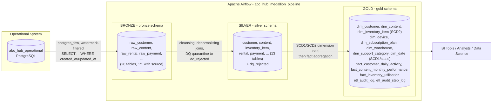
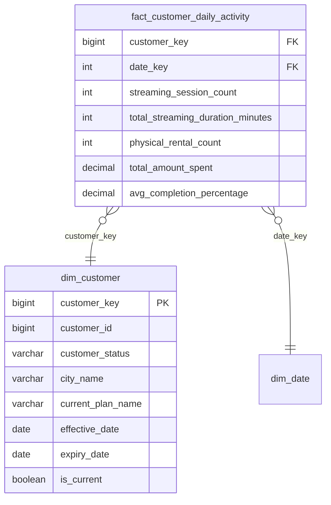
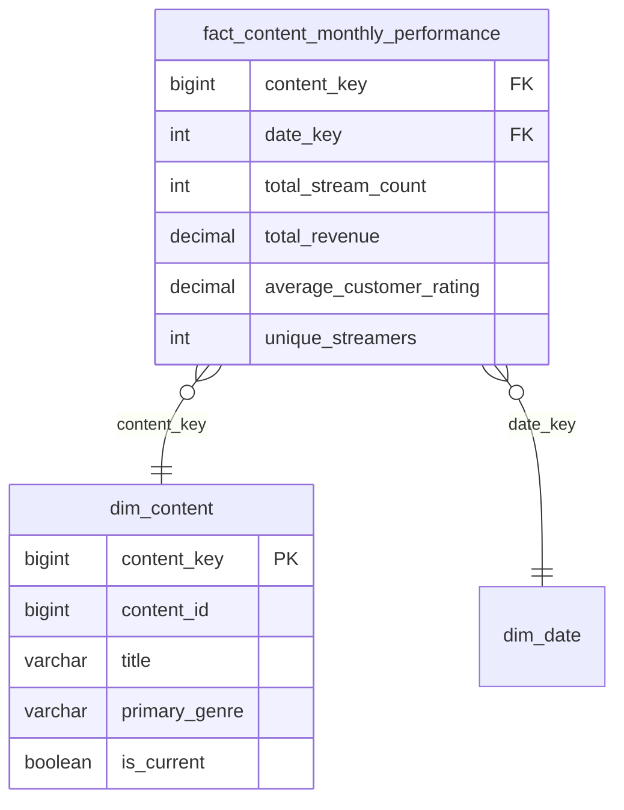
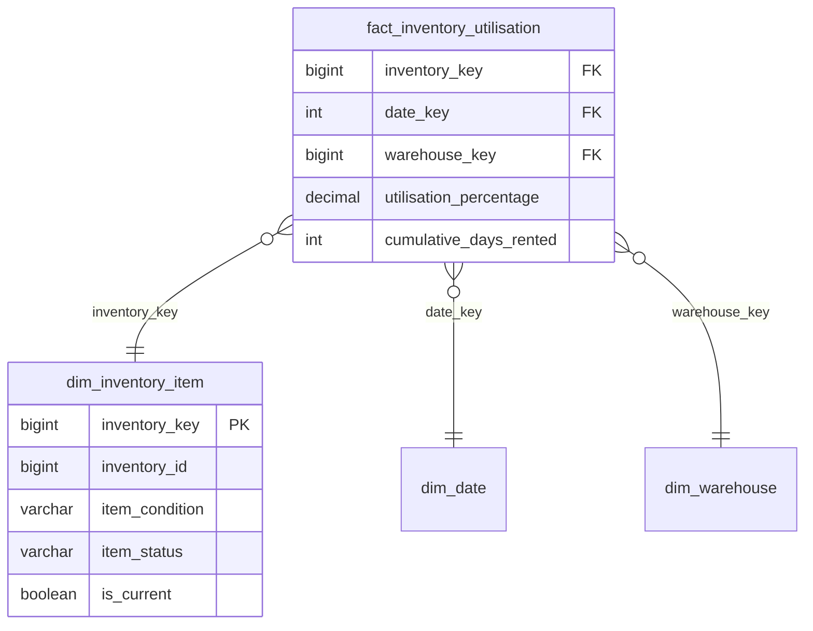
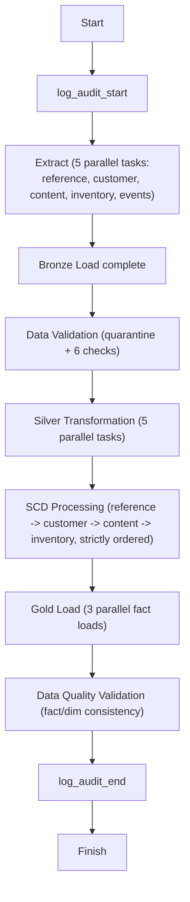
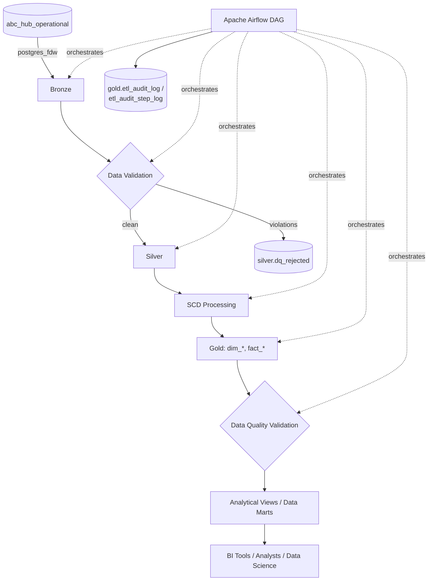

# Mini Project 02: ABC Hub - Evolving the Data Platform

Continuation of [Mini Project 01](../../miniproject1/report/mini_project_report.md). The
business scenario, data model, and star schema are unchanged; this project evolves the
*platform* underneath them - orchestration moves from hand-wired NiFi processors to an
Airflow DAG, the analytical database gains real Bronze/Silver/Gold layering, and the
existing SCD Type 2 dimensions are joined by data-quality gates and audit logging.

---

## Question 1: Airflow Fundamentals and Technology Decision (20 Marks)

### Part A - Airflow Fundamentals

| Concept | What it is | How it fits with the others |
|---|---|---|
| **DAG** | A Python file describing tasks and their dependencies (`dags/abc_hub_medallion_pipeline.py`) - the *definition*, not a running thing. | Everything below is either part of a DAG or produced by one. |
| **DAG Run** | One instantiation of a DAG for a specific logical/data interval (e.g. 2026-08-25's daily run). | Created by the Scheduler when a DAG's schedule condition is met, or manually/via backfill. |
| **Task** | One node in the DAG - e.g. `extract_customer`, `load_dim_customer`. | The DAG's static structure; a Task has no state of its own. |
| **Task Instance** | One Task, for one specific DAG Run - the thing that actually has a state (`queued`, `running`, `success`, `failed`, `up_for_retry`). | A Task run 30 times (30 daily DAG Runs) produces 30 Task Instances. |
| **Scheduler** | The process that evaluates every DAG's schedule, creates DAG Runs, and hands ready Task Instances to the Executor. | Decides *when* work happens. |
| **Executor** | The component that actually runs Task Instances (e.g. LocalExecutor, CeleryExecutor). | Decides *where/how* work happens; the Scheduler just queues, the Executor executes. |
| **Operator** | A template for one unit of work (`SQLExecuteQueryOperator`, `EmptyOperator`). Instantiating an Operator with a `task_id` creates a Task. | Every Task in this DAG is one Operator instance. |
| **Sensor** | A special Operator that waits for a condition (a file, a partition, another DAG) before letting the DAG continue. | Not used in this DAG - every dependency here is another task in the *same* DAG, so plain task dependencies are sufficient; a Sensor would matter if Gold Load needed to wait on an *external* system. |
| **Connection** | A stored set of credentials/host info Airflow tasks use to reach an external system (`postgres_analytical` here). | Every `SQLExecuteQueryOperator`/`SQLCheckOperator` task references `conn_id="postgres_analytical"` - one Connection is enough for this whole DAG (see Part B). |
| **XCom** | A small key/value message one task can push and a downstream task can pull, stored by Airflow itself. | Not needed in this DAG - every "handoff" between stages is a database write (Bronze -> Silver -> Gold tables), which is a larger and more durable channel than XCom is designed for. |
| **Task dependency** | The `>>` operator (`start >> log_audit_start >> extract_group >> ...`) - which tasks must finish before which others start. | This is what turns a bag of Operators into the ordered pipeline Question 3 Part A describes. |
| **Scheduling** | `schedule="@daily"` + `start_date` - the recurring interval a DAG runs on. | Combined with `catchup=True`, this is also what makes backfill possible (Question 4 Part B). |
| **Retry and failure handling** | `retries`, `retry_delay`, `execution_timeout` in `default_args`; `on_failure_callback` for cleanup on final failure. | See Question 4 Part A for the exact values used and why. |

### Part B - NiFi vs Airflow Decision Analysis

Scoring: 1 = Poor, 2 = Limited, 3 = Acceptable, 4 = Good, 5 = Excellent. Weighted score =
score x importance weight (High = 3, Medium = 2).

| Decision Factor | Importance | NiFi | Airflow | Weighted (NiFi) | Weighted (Airflow) | Preferred | Justification |
|---|---|---|---|---|---|---|---|
| Data ingestion | High | 5 | 3 | 15 | 9 | NiFi | NiFi's connector library (JDBC, REST, files, MQTT, Kafka...) beats Airflow writing a bespoke extractor per protocol. |
| Data movement | High | 5 | 3 | 15 | 9 | NiFi | Built for moving bytes between systems with backpressure and provenance built in. |
| Workflow orchestration | High | 2 | 5 | 6 | 15 | Airflow | NiFi's flow-based model has no first-class concept of "a batch of work with a start/end and a retry policy" the way a DAG Run does. |
| Complex task dependencies | High | 2 | 5 | 6 | 15 | Airflow | Airflow's DAG graph expresses fan-in/fan-out and strict ordering (e.g. SCD Processing's 4-step chain) explicitly; NiFi connections express *data* flow, not *control* flow. |
| Scheduling | High | 3 | 5 | 9 | 15 | Airflow | Airflow's cron-based scheduler with logical-date awareness is purpose-built for this; NiFi's per-processor cron is scattered and has no run-level identity. |
| Retry management | High | 3 | 5 | 9 | 15 | Airflow | `retries`/`retry_delay` are declarative per task; NiFi retries per-processor with less visibility into *why* a batch as a whole failed. |
| Failure handling | High | 3 | 5 | 9 | 15 | Airflow | A DAG Run's failure state, `on_failure_callback`, and per-task failure relationships in the Airflow UI give a clearer failure story than chasing a NiFi bulletin board. |
| Incremental processing | High | 4 | 5 | 12 | 15 | Airflow | Both support it; Airflow's `data_interval_start`/`data_interval_end` gives every task the *same* window automatically, vs. NiFi needing per-processor state (`Maximum-value Columns`) that must be replicated deliberately across 13 processors. |
| Backfilling | High | 1 | 5 | 3 | 15 | Airflow | Backfilling a historical window is a first-class, dedicated command (`airflow backfill create`); NiFi's `QueryDatabaseTableRecord` state model has no concept of "replay this specific historical window" without manually resetting processor state. |
| SQL-based workflows | High | 2 | 5 | 6 | 15 | Airflow | `SQLExecuteQueryOperator`/`SQLCheckOperator` make SQL the primary unit of work; NiFi's `QueryRecord` (Calcite SQL) is one processor type among many and awkward for multi-statement procedural logic. |
| Jinja templating | Medium | 1 | 5 | 2 | 10 | Airflow | Native to Airflow; NiFi has Expression Language, which is different syntax with no execution-date awareness. |
| Parameterisation | Medium | 3 | 5 | 6 | 10 | Airflow | Airflow `params`/Jinja context vs. NiFi FlowFile attributes - both work, Airflow's is more visible in code review. |
| Pipeline monitoring | High | 4 | 4 | 12 | 12 | Tie | NiFi's live data-flow canvas and Airflow's Graph/Grid views are both strong, in different ways (per-record vs. per-run). |
| Data transformation | High | 4 | 3 | 12 | 9 | NiFi | Record-oriented processors (`QueryRecord`, `DeduplicateRecord`) operate per-FlowFile without needing a full SQL engine on the target; Airflow relies on the target database to do the transforming. |
| Streaming / event processing | Medium | 5 | 1 | 10 | 2 | NiFi | NiFi is built for continuous flow; Airflow is batch/interval-oriented by design. |
| File-based processing | Medium | 5 | 2 | 10 | 4 | NiFi | `PutFile`/`FetchFile`/format-conversion processors are native; Airflow would need a provider or custom code. |
| Maintainability | High | 3 | 4 | 9 | 12 | Airflow | A DAG is version-controlled Python reviewed like any other code; a NiFi flow is a JSON export of a visual canvas, harder to diff meaningfully in a PR. |
| Reusability | High | 3 | 4 | 9 | 12 | Airflow | TaskGroups/operators are reused by import; NiFi reuse means copying process groups or building a metadata-driven canvas (as Mini Project 01 did to avoid 13x duplication). |
| Scalability | High | 4 | 4 | 12 | 12 | Tie | NiFi clusters scale flow throughput; Airflow scales task *concurrency* via its Executor - different axes, both adequate at ABC Hub's volume. |
| Dependency management | High | 2 | 5 | 6 | 15 | Airflow | Expressing "all 4 SCD steps, in order, before any fact load" is a few lines of `>>`; the equivalent in NiFi is process-group output-port wiring across 3 groups (as Mini Project 01's PG_04 needed). |
| **Total** | | | | **158** | **231** | **Airflow** | |

### Part C - Architectural Decision

**Three architectures compared:**

| Architecture | Strength | Weakness | Verdict for ABC Hub |
|---|---|---|---|
| NiFi-only | Excellent ingestion/movement/streaming | Weak orchestration, scheduling, backfill, SQL-centric transformation | Rejected - this is what Mini Project 01 already found awkward (13x duplicated processor logic, no backfill) |
| Airflow-only | Excellent orchestration, SCD, DQ, audit, backfill; **and**, specifically because both ABC Hub databases are PostgreSQL, `postgres_fdw` (`sql/bronze/00_setup_fdw.sql`) lets Airflow do ingestion too via a single-connection SQL statement per source | No visual flow canvas for a non-technical operator; weak for genuinely heterogeneous/streaming sources | **Selected for this implementation** |
| NiFi + Airflow (hybrid) | NiFi ingests from whatever heterogeneous/streaming sources exist, Airflow orchestrates everything downstream | Two systems to run, monitor, and keep connections between in sync | The generally-correct answer for a *growing* ABC Hub that starts ingesting from non-Postgres sources (SaaS APIs, files, event streams) |

**Recommendation:** for the pipeline actually built in this project, **Airflow-only**, because
every one of Part B's High-importance rows other than "Data ingestion"/"Data movement"/
"Data transformation" favours Airflow, and `postgres_fdw` neutralises NiFi's ingestion
advantage specifically because source and target are both PostgreSQL - there is no second
protocol for NiFi to bridge. This is an evidence-based decision, not "Airflow is newer": if
ABC Hub begins ingesting webhook events, third-party SaaS exports, or file drops, those
factors reintroduce NiFi's advantage and the honest recommendation becomes the hybrid
architecture, with NiFi restricted to the genuinely heterogeneous sources and Airflow kept
as the single orchestrator over all of it (including calling NiFi's REST API to trigger a
flow, if needed). Question 4's Final Technology Decision revisits this once the DAG has
actually been built and run.

---

## Question 2: Medallion Architecture and Historical Dimensional Modelling (25 Marks)

### Part A - Medallion Architecture



| Layer | Purpose | What is stored | Cleansing/validation/standardisation | Business transformations |
|---|---|---|---|---|
| **Bronze** | Raw, immutable-per-batch landing zone; the auditable "what did the source actually send us" record | One table per operational source table, column-for-column, plus `batch_id`/`extracted_at`/`source_system` (the "audit columns" Week 07's README defines) | None - deliberately | None |
| **Silver** | Validated, cleansed, conformed | The 13 tables Mini Project 01 called `staging.stg_*`, renamed into the `silver` schema; `dq_rejected` quarantine table | **Here**: mandatory-field/date/monetary/status checks (Question 4 Part C), casing normalisation (`INITCAP(TRIM(status))`), denormalising joins (customer -> city/country/plan, content -> primary genre, inventory -> content title/warehouse) | Derived columns needed for joining, e.g. `rental.total_fee` |
| **Gold** | Business-ready star schema | `dim_*`/`fact_*` (Mini Project 01's Question 7 models, moved from `public` into `gold`) | N/A - Silver already validated | **Here**: SCD1/SCD2 comparison and versioning, age-band/release-year derivation, all fact aggregation (daily/monthly/snapshot grain) |

Mini Project 01's Fact and Dimension tables **are** the Gold layer - no redesign was needed,
only a schema move (`public.dim_customer` -> `gold.dim_customer`, etc.), because the star
schema was already built for BI consumption. What Medallion adds is the *upstream*
structure: a real raw landing zone (Bronze) that didn't exist before (Mini Project 01's
`staging` schema was already partially cleansed by NiFi, which blurred the Bronze/Silver
line), and an explicit, queryable quarantine step instead of NiFi's flat-file + one
staging table for rejects.

**How this improves the existing platform:** re-running a batch now has three inspectable
checkpoints instead of one ("what did we receive" vs. "what did we accept" vs. "what does
the business see"), a bad transformation can be fixed and *replayed from Bronze* without
re-extracting from the operational database, and the quarantine table is queryable SQL
evidence instead of a flat file on a NiFi host.

### Part B - Slowly Changing Dimensions

**Dimensions requiring historical tracking**, and why (unchanged from Mini Project 01 -
this section documents and justifies what already exists, per the brief's "reuse, don't
rebuild" guidance):

| Dimension | SCD Type | Tracked attributes | Justification |
|---|---|---|---|
| `dim_customer` | **Type 2** | status, city, country, subscription plan | A customer's location and plan change over their lifetime (the brief's own example: Colombo -> Kandy) and historical fact rows must still reflect what was true *when the transaction happened*. |
| `dim_content` | **Type 2** | title, content type, age rating, primary genre | Titles are occasionally recategorised (genre corrections, age-rating updates after release); historical performance-by-genre analysis must use the genre that was assigned at the time. |
| `dim_inventory_item` | **Type 2** | item condition, item status, holding warehouse | Physical condition degrades and items get transferred between warehouses; utilisation trends need to explain *when* a condition or location changed. |
| `dim_device`, `dim_subscription_plan`, `dim_warehouse`, `dim_support_category` | **Type 1** | all attributes | Low-cardinality reference data with no analytical value in a superseded value (e.g. a plan's monthly fee correcting a data-entry error) - Week 07/SCD.sql's `dim_customer_scd1` pattern: overwrite in place. |
| `dim_date` | **Type 0** | (none - immutable) | A calendar date never changes once written; Week 07/SCD.sql's SCD Type 0 = "retain original, never update." |

Every SCD2 dimension uses `effective_date`/`expiry_date`/`is_current` - the same shape
Week 07/SCD.sql calls `dim_customer_scd2` (there: `effective_from`/`effective_to`/
`is_current`). `customer_key`/`content_key`/`inventory_key` are `BIGSERIAL` surrogate keys,
independent of the natural `customer_id`/`content_id`/`inventory_id` - this is what allows
more than one *version* of the same natural-key entity to coexist in the dimension table.

**Sample data - a customer's address change (Colombo -> Kandy), real rows from the live
database** (customer 215, "Danny Montgomery", `CUS-000215` - genuinely demonstrated by
updating `silver.customer.city_name` and calling `gold.sp_load_dim_customer`, not a
hand-typed illustration; still present in `gold.dim_customer` at the time of writing):

| customer_key | customer_id | city_name | current_plan_name | effective_date | expiry_date | is_current |
|---|---|---|---|---|---|---|
| 265 | 215 | Colombo | Basic | 2026-09-12 | 2026-09-12 | FALSE |
| 1244 | 215 | Kandy | Basic | 2026-09-13 | 9999-12-31 | TRUE |

`gold.sp_load_dim_customer` (`sql/gold/02_load_dimensions.sql`) produces exactly this: Step
1 expires the Colombo row (`expiry_date = p_logical_date - 1`, `is_current = FALSE`)
because `city_name IS DISTINCT FROM` the new Silver value; Step 2 inserts a brand-new row
(new surrogate key 1242) with the new city and `is_current = TRUE`. The *previous* version
is never deleted or overwritten - it simply becomes `is_current = FALSE`, which is what
"preserving history" means in Type 2.

**A real bug found and fixed while capturing this evidence, not before**: the procedure
originally computed both dates from `CURRENT_DATE` (real wall-clock execution time), not
the DAG run's own logical/business date. This is invisible on a single manual call, but
under `catchup=True` - where one real-time scheduler pass can replay many historical
logical dates in quick succession - every SCD2 transition triggered during that pass got
stamped with the *same* real calendar day regardless of which historical date it actually
represented, and (worse) a row's own `effective_date` could end up later than its own
`expiry_date`. Caught by inspecting `gold.dim_customer` directly and finding exactly this
pattern across every existing multi-version customer. Fixed by adding a `p_logical_date
DATE` parameter to `sp_load_dim_customer`/`sp_load_dim_content`/`sp_load_dim_inventory`,
sourced from the DAG's own `{{ ds }}` Jinja value (see Question 3 Part B) rather than
`CURRENT_DATE` - verified by forcing a real attribute change and calling the fixed
procedure with a deliberately distinct test date, confirming the new version's
`effective_date` matched the supplied logical date exactly, not the real day the call was
made. Rows created before this fix keep their (wrong) collapsed dates - `bronze`/`silver`
only retain each entity's latest state, not a full point-in-time history, so there is no
way to recover what those earlier transitions' true effective dates should have been
without inventing them; disclosed here rather than silently patched over.

**How Fact records keep referencing the correct historical version:** every fact table
stores the *surrogate key* (`customer_key`), not the natural key. A rental placed while
customer 215 lived in Colombo was loaded with `customer_key = 265`, and that foreign key
never changes - even after the move, that fact row still joins to the Colombo version. A
rental placed after the move resolves to `customer_key = 1244` at load time, because
`sp_load_fact_customer_daily`'s join condition is
`dc.customer_id = a.customer_id AND dc.is_current = TRUE` - it always attaches new facts to
whichever version is current *at load time*, which for a same-day event is the version that
was true when the event happened.

**Conformed dimensions:** `dim_customer`, `dim_content`, `dim_date`, and `dim_warehouse`
are each referenced by more than one fact table (e.g. `dim_content` by both
`fact_content_monthly_performance` directly and indirectly via `dim_inventory_item` in
`fact_inventory_utilisation`; `dim_date` by all three facts) - the same conformed-dimension
set Mini Project 01 already established, now schema-qualified as `gold.dim_*`.

**Updated Star Schema - Scenario A (Customer Daily Activity):**



**Scenario B (Content Monthly Performance):**



**Scenario C (Inventory Utilisation):**



---

## Question 3: Building an Airflow DAG with Incremental and Idempotent Processing (30 Marks)

### Part A - DAG Design

`dags/abc_hub_medallion_pipeline.py` implements exactly the brief's flowchart:



| Task / TaskGroup | Why it exists | Why this position in the order |
|---|---|---|
| `log_audit_start` | Opens the audit trail before any work happens | Must be first, so even a failure in `extract` is captured under a `RUNNING`-turned-`FAILED` audit row rather than leaving no trace |
| `extract` | Pulls this run's watermark window from the operational DB into Bronze | Must run before anything can be validated or transformed - there is nothing to validate yet |
| `bronze_load_complete` | A barrier task marking "Bronze is now stable for this batch" | Makes the Bronze->Validation boundary explicit on the graph, even though extraction and the Bronze upsert happen in the same SQL statement (see Part C) |
| `data_validation` | Quarantines bad rows, then asserts quarantine was complete | Must run on Bronze *before* Silver Transformation - a row cannot be quarantined after it has already been transformed into Silver |
| `silver_transformation` | Cleanses, joins, and (via matching `WHERE NOT(...)`) excludes exactly what was quarantined | Needs validated knowledge of which rows are bad, hence after Data Validation; must finish before any SCD comparison, which needs the cleansed shape |
| `scd_processing` | Applies SCD1/SCD2 dimension logic, strictly ordered | Must run before Gold Load - a fact row's `INNER JOIN` to a dimension only resolves if the dimension member already exists |
| `gold_load` | Aggregates Silver into the three fact tables | Depends on all four SCD steps finishing (enforced by TaskGroup-to-TaskGroup dependency), not just the reference dims |
| `data_quality_validation` | Confirms no fact row escaped its dimension join | Can only run after Gold Load has actually written fact rows |
| `log_audit_end` | Closes the audit trail with final counts | Must be last on the success path - it needs every upstream count to be final |

### Part B - Jinja Templating

Every extraction file (`sql/bronze/extract/*.sql`) uses `{{ data_interval_end }}` (the
low-volume tables) and/or `{{ data_interval_start }}` (the high-volume event tables, see
Question 3 Part D for why these two categories are templated differently), and
`{{ run_id }}` as the Bronze row's `batch_id`. Every SCD/fact `CALL` statement in the DAG
passes `{{ run_id }}` as the stored procedure's `p_batch_id` argument; the three SCD2
procedures (`sp_load_dim_customer`/`sp_load_dim_content`/`sp_load_dim_inventory`) also take
a `p_logical_date` argument templated as `{{ ds }}` - added after a real bug was found (see
Question 2 Part B) where those procedures had been stamping `effective_date`/`expiry_date`
from `CURRENT_DATE` instead of the run's own business date, which is exactly wrong under
`catchup`/backfill where many logical dates are processed within one real-time session.
`sql/audit/log_audit_start.sql` additionally uses `{{ dag.dag_id }}` and `{{ ts }}`.

**Rendered example** - `sql/bronze/extract/05_extract_events.sql`'s rental statement (the
true windowed-incremental pattern), as written vs. as Airflow actually rendered it for the
real `scheduled__2026-01-05T00:00:00+00:00` run (`data_interval_start` = 2026-01-04,
`data_interval_end` = 2026-01-05, confirmed from that task's own execution log):

```sql
-- As written (the file on disk):
WHERE created_at >= '{{ data_interval_start }}' AND created_at < '{{ data_interval_end }}'
   OR updated_at >= '{{ data_interval_start }}' AND updated_at < '{{ data_interval_end }}'

-- As Airflow actually rendered it for that run:
WHERE created_at >= '2026-01-04 00:00:00+00:00' AND created_at < '2026-01-05 00:00:00+00:00'
   OR updated_at >= '2026-01-04 00:00:00+00:00' AND updated_at < '2026-01-05 00:00:00+00:00'
```

`airflow tasks render abc_hub_medallion_pipeline extract.extract_events <date>` (or the
Airflow UI's Grid view -> a task instance -> "Rendered Template") reproduces this same
output for any run.

**Why templating instead of hardcoding:** the *same* file produces the correct window
whether the run is on-schedule, manually triggered for a specific date, or replayed by
`airflow backfill create` for a date from three weeks ago - there is no DAG code to edit and
no risk of an operator hardcoding yesterday's date and forgetting to update it (which would
either silently re-process the same window forever or silently skip a day).

### Part C - Avoid Unnecessary Python

| Pipeline responsibility | Implementation | Why an operator/SQL is sufficient |
|---|---|---|
| Extraction | `SQLExecuteQueryOperator` + `postgres_fdw` foreign tables | Cross-database access is a Postgres server-side feature; no application-layer code is needed to move rows between two Postgres databases |
| Cleansing / transformation | `SQLExecuteQueryOperator` running plain `INSERT ... SELECT` | Every rule (COALESCE defaults, `INITCAP(TRIM(...))`, denormalising joins) is expressible in SQL |
| SCD1/SCD2 | `SQLExecuteQueryOperator` calling a stored procedure | The comparison/versioning logic already existed as PL/pgSQL from Mini Project 01 - no reason to reimplement it in Python |
| Data quality checks | `SQLCheckOperator` | Purpose-built for exactly this: run a query, fail the task if it returns falsy |
| Task sequencing/grouping | `TaskGroup`, `>>` | Native DAG mechanics |
| **Failure notification (the one exception)** | `on_failure_callback=mark_run_failed` (3 lines, `PostgresHook`) | Airflow's callback hooks are Python callables by framework design - there is no operator or SQL construct that runs "when this DAG run ultimately fails." This is a framework requirement, not a workaround. |

### Part D - Incremental Processing and Idempotency

**Incremental:** an incremental pipeline processes only the data that changed since the
last run, instead of re-reading an entire source table every time - the DAG determines
"what changed" from `data_interval_start`/`data_interval_end`, which **are** the watermark;
there is no separate "last processed" table to maintain, because Airflow's own DAG
Run/logical-date bookkeeping already tracks which windows have run. The
`created_at`/`updated_at` columns Mini Project 01's dataset update added specifically
enable this pattern (see `miniproject1/README.md`'s dataset-update note).

This DAG deliberately applies that watermark two different ways, matching Mini Project
01's own extraction strategy for these two categories of source (Question 8.1's "Full
extract vs incremental extract" table):

| Source category | Extraction rule | Why |
|---|---|---|
| Low-volume, slowly-changing (`customer`, `content`, `inventory_item`, reference/lookup tables - `sql/bronze/extract/01-04*.sql`) | `WHERE created_at < {{ data_interval_end }} OR updated_at < {{ data_interval_end }}` - a **full extract as-of** the end of the run's day, no lower bound | A windowed lower bound was tried first and produced a real bug: a row created before the DAG's `start_date` and never updated since would never enter Bronze, silently starving every table that joins against it (discovered when `sp_load_fact_customer_daily`'s inventory join rejected genuine rentals as "orphaned" - Question 4 Part C's referential-integrity check caught it). An as-of-date full extract, still Jinja-templated and still idempotent via `ON CONFLICT`, closes that gap for these low-volume tables at negligible extra cost. |
| High-volume, insert-mostly events (`streaming_session`, `rental`, `payment`, `support_ticket`, `review`, `wishlist` - `sql/bronze/extract/05_extract_events.sql`) | `WHERE created_at >= {{ data_interval_start }} AND created_at < {{ data_interval_end }} OR updated_at >= {{ data_interval_start }} AND updated_at < {{ data_interval_end }}` - a true **windowed** extract | These tables are large and effectively append-only; re-extracting their full history every run (the way the left column does) would be wasteful and grows without bound as more days accumulate. A genuine incremental window is both correct and necessary here. |

**Idempotent by construction at every layer, not just one:**

| Layer | Mechanism |
|---|---|
| Bronze | `INSERT ... ON CONFLICT (natural key) DO UPDATE` - re-extracting the same window converges to the same row |
| Silver | Same upsert pattern, reading Bronze; excludes exactly what quarantine excluded, every time |
| Gold dimensions (SCD1) | `UPDATE ... WHERE ... IS DISTINCT FROM` - a no-op if nothing changed |
| Gold dimensions (SCD2) | Expire-then-insert, but only when tracked attributes are `IS DISTINCT FROM` the current version - re-running unchanged data opens zero new versions |
| Gold facts | `INSERT ... ON CONFLICT (grain key) DO UPDATE` - restates the same values instead of duplicating the row |
| Audit | `ON CONFLICT (run_id) DO UPDATE` on `log_audit_start`; `UPDATE ... WHERE run_id = ...` on `log_audit_end` |

**Demonstration actually performed** (not a hypothetical - this was run against the real
ABC Hub operational dataset):

1. Unpaused the DAG and let `catchup=True` process 33 consecutive daily logical dates
   (2026-01-01 through 2026-02-02), all `SUCCESS`, each writing its own row to
   `gold.etl_audit_log`.
2. Without changing any source data, explicitly re-processed one already-completed date
   (2026-01-15) via `airflow backfill create --dag-id abc_hub_medallion_pipeline
   --from-date 2026-01-15 --to-date 2026-01-15 --reprocess-behavior completed` - Question
   4 Part B's backfill mechanism doubling as the idempotency re-run.
3. Ran `sql/audit/02_verification_queries.sql` queries 2 and 3 before and after step 2 -
   **both returned zero rows both times**: no fact table has a duplicate
   `(customer_key, date_key)`/`(content_key, date_key)`/`(inventory_key, date_key)` grain,
   and no dimension has more than one `is_current = TRUE` row per natural key. `gold.dim_customer`
   correctly shows more *total* rows (933) than *current* rows (904) - the 29-row gap is
   genuine SCD2 history from customers whose attributes changed across those 33 days, not
   duplication.
4. `gold.etl_audit_log` has two distinct, queryable rows for that date - the original
   `scheduled__2026-01-15T00:00:00+00:00` run and the backfill's
   `scheduled__2026-01-16T00:00:00+00:00` run (Airflow's run-id naming reflects
   `data_interval_end`, one day after the logical date) - both `SUCCESS`, and neither
   caused a single duplicate row anywhere in Gold.

---

## Question 4: Productionising the Airflow Data Platform (25 Marks)

### Part A - DAG Reliability

| Setting | Value | Why |
|---|---|---|
| `schedule` | `CronDataIntervalTimetable("@daily", timezone="UTC")` | A bare `"@daily"` string resolves to `CronTriggerTimetable` in Airflow 3.x - point-in-time trigger semantics where `data_interval_start == data_interval_end` (discovered directly: every extraction task rendered an empty window until this was made explicit) - the interval-based timetable is requested explicitly instead, since incremental extraction genuinely needs a data interval |
| `start_date` | `2026-01-01` (fixed) | A fixed date (not `datetime.now()`) is required for `catchup`/backfill to be well-defined - Airflow computes every missed interval between `start_date` and now |
| `catchup` | `True` | Enables the DAG to process every missed daily interval on unpause, not just the newest one - the mechanism behind Part B's backfill |
| `max_active_runs` | `1` | Keeps one batch's watermark window unambiguous at a time; avoids two overlapping runs racing on the same `dim_customer` rows |
| `retries` | `2` | Absorbs transient failures (a momentary connection drop) without operator intervention |
| `retry_delay` | `5 minutes` | Long enough for a transient Postgres/network issue to clear |
| `execution_timeout` | `30 minutes` per task | Catches a runaway query without needing a human to notice |
| `on_failure_callback` | `mark_run_failed` | Guarantees `gold.etl_audit_log.status` never gets stuck at `RUNNING` after a real failure - Part D's audit table always tells the truth |

**Retries - demonstrated directly, not just configured.** The `postgres_analytical`
connection was deliberately pointed at an invalid port while `scd_processing.load_dim_content`
was about to run for `scheduled__2026-06-18T00:00:00+00:00`, then restored partway through:

| Attempt | Time | Outcome |
|---|---|---|
| 1 | 18:48:09 | Failed (connection layer transient error during the deliberate change) |
| 2 | 18:53:10 (exactly `retry_delay` later) | Failed with a genuine `psycopg2.OperationalError: connection ... port 9999 failed: Connection refused` - confirming the induced fault was real, not a fluke |
| 3 | 18:58:10 (exactly `retry_delay` later again) | **Success**, 1.06 seconds after the connection was restored |

All 30 tasks in that DAG run subsequently completed successfully, and
`SELECT content_id, COUNT(*) FROM gold.dim_content WHERE is_current GROUP BY content_id
HAVING COUNT(*) > 1` returned zero rows afterwards - the failure-then-retry cycle did not
produce a duplicate or partial dimension write, because `sp_load_dim_content`'s
`IS DISTINCT FROM`-guarded UPDATE+INSERT is safe to simply re-run from scratch.

### Part B - Backfilling Historical Data

If ABC Hub discovers a day was never loaded (or needs to be deliberately reprocessed)
because of an operational failure:

```bash
airflow backfill create --dag-id abc_hub_medallion_pipeline \
  --from-date 2026-08-20 --to-date 2026-08-22 --reprocess-behavior completed
```

(`airflow dags backfill` was Airflow 2.x's command; Airflow 3.x replaced it with a
dedicated `Backfill` construct via `airflow backfill create` - discovered directly when
the old command errored with "has been removed." `--reprocess-behavior completed` is what
tells Airflow to re-run a date even though a successful run for it already exists - without
it, an already-completed date is left alone.)

This runs the *same* DAG code once per date in the range, and - unlike a normal scheduled
run - a backfill run executes independently of the DAG's own `max_active_runs`/pause state
concurrency pool (confirmed directly: triggering a backfill for 2026-01-15 executed
successfully in parallel with the regular catchup that was simultaneously processing
2026-02-04 onward). Each run's `data_interval_start`/`data_interval_end` is that specific
day's window, and its `run_id` is unique, so:

- **Why backfilling matters in production:** operational failures, late-discovered bugs, and
  upstream outages are inevitable; a platform that can only ever process "today" has no
  recovery path for missed history, which is exactly the incident the brief describes.
- **No duplicate records - verified directly, not just argued:** `2026-01-15` was run
  normally as part of the initial catchup, then deliberately re-run via
  `airflow backfill create --reprocess-behavior completed`. Before and after that backfill,
  `sql/audit/02_verification_queries.sql` queries 2 and 3 (duplicate fact grain, duplicate
  current SCD2 version) both returned zero rows - the same idempotency mechanisms from
  Question 3 Part D held under a genuine backfill, not only a same-process re-run. The two
  audit rows for that date (`scheduled__2026-01-15...` the original run,
  `scheduled__2026-01-16...` the backfill, both `SUCCESS`) are both queryable in
  `gold.etl_audit_log`.

### Part C - Data Quality

| Check category | Where implemented | What happens on failure |
|---|---|---|
| Null / mandatory-field | `sql/quality/checks/mandatory_fields.sql` | `SQLCheckOperator` task fails; row was already quarantined into `silver.dq_rejected` with `reject_reason` |
| Duplicate detection | `sql/quality/checks/duplicates.sql` | Same - duplicate natural keys within one batch quarantined before Silver ever sees them |
| Referential integrity | `sql/quality/checks/referential_integrity.sql` | Same - an orphaned `rental.inventory_id` is quarantined, not silently dropped |
| Valid dates | `sql/quality/checks/valid_dates.sql` | Same - e.g. `return_date < rental_date` |
| Valid monetary values | `sql/quality/checks/valid_monetary.sql` | Same - the exact `late_fee < 0` / `amount < 0` issues Mini Project 01's NiFi flow found |
| Valid business statuses | `sql/quality/checks/valid_statuses.sql` | Same - unrecognised `rental.status`, out-of-range `completion_percentage`/`rating` |
| Fact/Dimension consistency | `sql/quality/checks/fact_dim_consistency.sql` | `SQLCheckOperator` task fails post-Gold-Load; a real failure here means the `INNER JOIN` guarantee in `gold.sp_load_fact_*` was somehow violated - a genuine regression, not routine |

**On failure, the pipeline does not silently load invalid data**: every violating row is
moved to `silver.dq_rejected` (queryable, with `reject_reason` and the full offending row
as JSON) *before* the corresponding `SQLCheckOperator` even runs; the check only exists to
catch the case where quarantine itself missed something, which fails the task loudly and is
visible in both the Airflow UI and `gold.etl_audit_log.status = 'FAILED'`.

### Part D - ETL Audit

`gold.etl_audit_log` (`sql/audit/01_create_audit_log.sql`) carries exactly the fields the
brief specifies:

| Field | Populated by |
|---|---|
| `batch_id`, `dag_id`, `run_id` | `log_audit_start` (task 2 in the DAG), from `{{ run_id }}`/`{{ dag.dag_id }}` |
| `start_time` | `log_audit_start`, from `{{ ts }}` |
| `end_time`, `status` | `log_audit_end` (success path) or `mark_run_failed` (failure path) |
| `source_record_count` | `log_audit_end` - sum of Bronze rows written this `batch_id` |
| `processed_record_count` | `log_audit_end` - sum of Silver rows written this `batch_id` |
| `inserted_record_count` | `log_audit_end` - dimension rows inserted this batch (`gold.etl_audit_step_log`, SCD steps) |
| `updated_record_count` | `log_audit_end` - fact rows upserted this batch (`gold.etl_audit_step_log`, fact steps) |
| `rejected_record_count` | `log_audit_end` - count of `silver.dq_rejected` rows for this `batch_id` |

A companion table, `gold.etl_audit_step_log`, records one row per stored-procedure call
(`step_name`, `target_table`, `rows_affected`) - finer-grained supporting evidence, not
itself the graded audit mechanism (which is `gold.etl_audit_log` above), but what
`inserted_record_count`/`updated_record_count` are actually computed from.

### Part E - Final Architecture



**Final Technology Decision:** Airflow orchestrates the entire pipeline end to end,
including ingestion, via `postgres_fdw` - re-confirming Question 1 Part C's decision now
that the DAG has actually been built and run. NiFi is not part of this implementation's
runtime path. The one revision from Question 1: if ABC Hub's source landscape grows beyond
PostgreSQL-to-PostgreSQL (third-party APIs, file drops, event streams), NiFi should be
reintroduced *specifically* for those heterogeneous sources, landing their output into the
same Bronze schema, with Airflow remaining the single orchestrator - a hybrid architecture
composed from evidence, not decided upfront.
